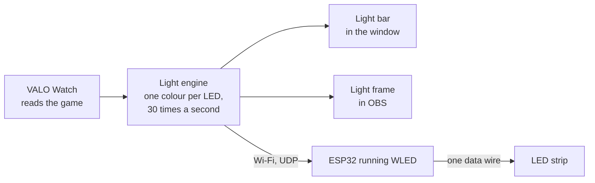

# LED strips

VALO Watch can play every event on a real LED strip, the same lights as the strip at the top of its window. This is the hardware guide; the manual covers the app.

**Prices** are what Egyptian electronics shops listed in November 2026. They change, so check before you go.

## How it works



- The strip is **addressable**: every LED has a chip in it and can be a different colour.
  That is what makes a sweep or a drain possible. An ordinary RGB strip, where the whole
  length is one colour, can only pulse.
- A small Wi-Fi board (an **ESP32**) sits between your network and the strip. It runs
  **WLED**, free firmware for exactly this job, which you install from a web page. You
  don't write or compile anything.
- VALO Watch sends WLED a list of colours over your network about 30 times a second while
  something is happening (the protocol is called DDP; UDP port 4048). WLED shows what it
  is sent.
- When VALO Watch stops sending, WLED goes back to its own effect after about 2.5 seconds.
  So the strip is an ordinary WLED light whenever you aren't playing.

From the event appearing in the game to the strip changing is about half a second, nearly
all of it the two readings the detector takes to be sure.


## What to buy

Prices are what Egyptian stores listed on **2026-11-16**. They move, and several listings
were out of stock, so check before you travel.

| part | what to ask for | price seen (EGP) | where |
|---|---|---|---|
| Controller | ESP32 development board, 30 or 38 pin, with CP2102 | 260 to 350 | [Future Electronics](https://store.fut-electronics.com/products/esp32-esp-wroom-32-38-pin-cp2102) 260 to 290, [RAM Electronics](https://www.ram-e-shop.com/shop/category/esp32-esp8266-boards-196) 280 to 350, Amazon.eg 430 to 550 |
| Strip | WS2812B, 5 V, 60 LEDs per metre, IP20 (not waterproof) | about 200 for 1 m; 675 to 1,000 for a 5 m reel | [3DUINO](https://www.3duino.com/product-tag/ws2812b/) 200 (1 m) and 750 (5 m), [Micro Ohm](https://microohm-eg.com/led-lighting/led-strip/) 750, [Makers Electronics](https://makerselectronics.com/product/ws2812-addressable-rgb-led-strip-60led-m-dc5v-ip20-reel-5m/) 675 to 980, Amazon.eg about 840 |
| Power | 5 V supply: 3 to 4 A for up to 1 m, 10 A for up to 5 m | 300 to 480 for 5 V 10 A | [Makers Electronics](https://makerselectronics.com/product/power-supply-5v-10a/) 370, [Micro Ohm](https://microohm-eg.com/product/power-supply-smps-5v-10a/) 390, Amazon.eg 400 to 480 |
| Small parts | 1000 µF capacitor (6.3 V or more), a 330 to 470 Ω resistor, hook-up wire, a micro-USB cable | under 100 | any of the above |

**About 900 EGP** gets you a 1 m strip running, and **about 1,500 EGP** a 5 m reel, which
is enough for a monitor and a wall.

Two things to know before buying:

- **Buy 5 V WS2812B.** WS2811 strips are usually 12 V and light their LEDs in groups of
  three, which makes the effects coarse. SK6812 works too and is a fine substitute.
- **The 5 V 10 A supplies are open metal boxes with bare mains screw terminals.** They are
  made to be mounted inside an enclosure. On a desk, either put it in a closed box or use
  a sealed plug-in 5 V 3 A or 4 A adapter and keep to one metre. If you have never wired
  mains, ask the shop to fit a cable and plug for you.

A **level shifter** is optional. The ESP32 speaks at 3.3 V and the strip expects 5 V; it
normally works anyway if the data wire from the board to the first LED is short (under
about 20 cm). If the strip flickers or shows wrong colours, add a 74AHCT125 or 74HCT245
chip on the data line. I couldn't find either in an Egyptian store's online listing, so
ask at the counter.

For comparison, a ready-made smart strip (Govee RGBIC) was listed at **3,000 to 4,500 EGP**
on Amazon.eg and noon. That is three times the price of the parts above, and VALO Watch
doesn't drive those yet.


## Put it together

```
 5 V supply (+) ───┬───────────────► strip  5V   (red)
                   │   1000 µF
                   ├──┤├──┐          (capacitor across + and −, at the strip's start)
 5 V supply (−) ───┼──────┴────────► strip  GND  (white or black)
                   │
                   ├───────────────► ESP32  GND
 5 V supply (+) ───────────────────► ESP32  VIN  (or 5V)
                                     ESP32  GPIO16 ──[ 330 Ω ]──► strip  DIN  (green)
```

- **Grounds must be joined.** The supply's minus, the strip's GND and the ESP32's GND all
  connect. Most "it does nothing" problems are a missing ground.
- **Power the strip from the supply, never through the ESP32.** The board's USB port can
  give about half an amp; a metre of strip can ask for three.
- Data goes into the end marked **DIN** (arrows on the strip point away from it).
- Don't have the USB cable and the 5 V supply both feeding the board while you wire.
  Flash it over USB first, unplug, then connect the supply.

**How many LEDs.** Around a 24-inch monitor is about 1.7 m, so 100 LEDs; a 27-inch is
about 1.9 m, 113 LEDs. A desk edge is 1.2 to 1.6 m.

**How much power.** One LED at full white draws about 60 mA, so a metre could draw 3.6 A.
Game colours are rarely white and the resting scene is dim: a metre idles around half an
amp. Tell WLED what your supply can give (below) and it will hold the strip to that.


## Set up WLED

1. Plug the ESP32 into your PC with a USB cable. In Chrome or Edge, open
   **install.wled.me**, press **Install** and pick the board's port.
2. When it finishes, the page offers to connect it to your Wi-Fi. It needs a **2.4 GHz**
   network; an ESP32 can't see 5 GHz.
3. Open the address it shows (something like `192.168.1.60`) in a browser. Under
   **Config → LED Preferences** set:
   - **Length**: how many LEDs you have
   - **GPIO**: 16
   - the type to **WS281x** and the colour order to **GRB**
   - **Maximum current**: your supply's rating less a fifth (2400 mA for a 3 A adapter,
     8000 mA for a 10 A supply)
4. In your router, reserve that address for the board, so it doesn't change.


## Connect VALO Watch

1. **Settings → Stream**: tick **Serve overlays for OBS and drive LED strips**.
2. **LED strip address (WLED)**: the board's address, such as `192.168.1.60`.
3. **LEDs on the strip**: the same number you gave WLED.
4. Save. The strip should take on the dim resting colour within a second.
5. Open the setup page (the address shown in the main window) and press the test buttons,
   or press **Play a demo match**.

Several strips: separate the addresses with commas. Give each its own length with a
colon, and put a minus in front of one that is mounted the other way round:
`192.168.1.60:100, -192.168.1.61:60`.

From the command line, without the control panel:

```bat
python valo_hub.py --wled 192.168.1.60 --leds 100 --demo
```

**Which way the effects run.** Effects are designed around the middle of the strip: a
burst starts there and spreads to both ends, a drain retreats to it. Mount the strip so
its middle is where you want that centre. Around a monitor, start at the bottom centre
and go round: the middle of the strip is then the top centre, which is what the light
frame on stream does.


## Where to put it, for a stream

In order of what your viewers get out of it:

1. **Behind you, in the camera's view.** A strip along a shelf or washing the wall behind
   your chair is the one the audience sees. This is the one to do first if you stream.
2. **Behind the monitor.** This one is for you. It is indirect light, so it never glares
   into the camera.
3. **Under the desk edge.** Looks good on a wide camera angle.

Point LEDs at a wall, not at the camera. Bare LEDs facing a webcam bloom into white blobs
and lose their colour. If the strip flickers or bands on camera, set the camera's
anti-flicker to 50 Hz and lower its shutter speed.


## If it doesn't work

| what you see | check |
|---|---|
| Nothing lights at all | grounds joined? Data into DIN, not DOUT? Does WLED's own page light the strip? If not, it's wiring or WLED settings, not VALO Watch |
| WLED works alone but ignores VALO Watch | the address in Settings → Stream; both on the same network; in WLED, **Config → Sync Interfaces → Realtime → Receive UDP realtime** is ticked. Some routers have "client isolation" on guest networks, which blocks this |
| Wrong colours (red and green swapped) | colour order in LED Preferences: try GRB, then RGB |
| Flicker, or the first LED misbehaves | shorten the data wire, add the resistor, then add a level shifter |
| The far end is dimmer or reddish | voltage drop. Feed 5 V and ground into the far end of the strip as well |
| It snaps back to a WLED effect mid-match | VALO Watch stopped sending for 2.5 s: was it closed or frozen? |
| Effects run backwards | put a minus before the address |
| Only part of the strip lights | the LED count in VALO Watch and in WLED must match |

The setup page lists each strip and says so if the PC can't reach it.

---

VALO Watch isn't endorsed by Riot Games and doesn't reflect the views or opinions of Riot
Games or anyone officially involved in producing or managing Riot Games properties. Riot
Games and VALORANT are trademarks or registered trademarks of Riot Games, Inc.
