# Matchlight manual

Matchlight watches your VALORANT screen and reacts to what happens in your match: kills,
deaths, revives, clutches, aces, round and match results. It shows them in its own
window, as banners over the game, on your stream in OBS, and on LED strips.

It only **looks** at the screen, the way OBS or Discord screen share does. It never
reads the game's memory and never presses a key or moves the mouse.

**Contents:** [Install](#1-install) · [First run](#2-first-run) ·
[During a match](#3-during-a-match) · [Banners over the game](#4-banners-over-the-game) ·
[Screen regions](#5-if-something-isnt-picked-up) · [Stream overlays](#6-stream-overlays-in-obs) ·
[OBS camera and scenes](#7-obs-camera-and-scenes) · [Twitch](#8-twitch-markers-and-clips) ·
[LED strips](#9-led-strips) · [Problems](#10-problems) · [Reporting a bug](#11-reporting-a-bug)

## 1. Install

1. Download **Matchlight.exe** from the
   [latest release](https://github.com/esistfarouk/matchlight-releases/releases).
2. Put it in a folder of its own, such as `Documents\Matchlight`. It saves its settings
   next to itself.
3. Double-click it. The first start takes a few seconds while it unpacks.

Windows may show **"Windows protected your PC"**. The app isn't code-signed yet: press
**More info**, then **Run anyway**.

You need Windows 10 or 11, and VALORANT set to **Windowed Fullscreen** (Settings → Video →
Display Mode), so the banners can appear over the game.

## 2. First run

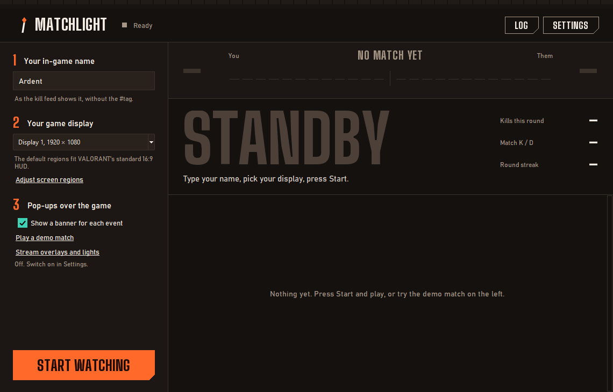

Three steps on the left:

1. **Your in-game name**, exactly as the kill feed shows it, without the `#tag`.
2. **Your game display**: the screen VALORANT is on.
3. **Pop-ups over the game**: leave it ticked.

Then press **Start watching**. That's all you need for the basics.

**Want to see it before playing?** Click **Play a demo match**. A made-up match plays
through the window, the banners and (if you've set them up) the stream and lights.
Nothing is read from the screen while it plays.

## 3. During a match

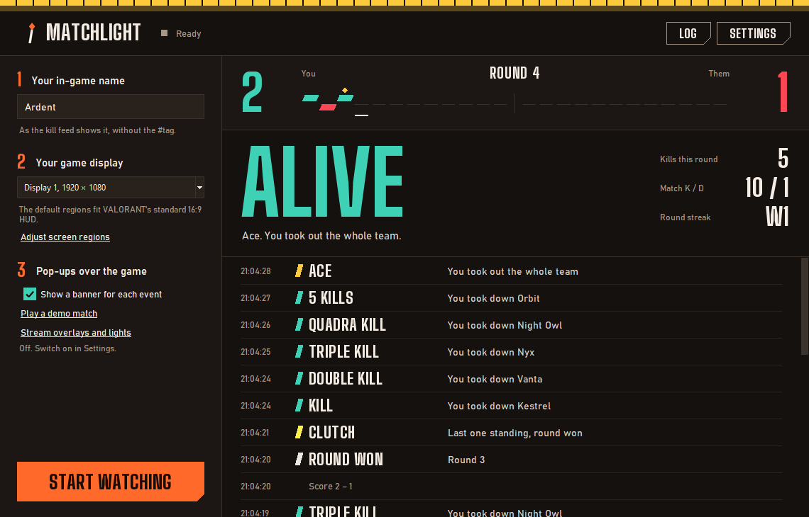

- **Top strip:** a row of lights that changes colour with what happens: teal while you're
  alive, red when you die, gold when you're the last one standing.
- **Score line:** your score, theirs, and one mark per round: up and teal for a win,
  down and red for a loss, a gold diamond for a round with an ace or clutch.
- **The big word:** where you stand: ALIVE, DEAD, REVIVED, LAST ALIVE, VICTORY, DEFEAT.
  Next to it: kills this round, K/D for the match, and your round streak (W3 = three wins
  in a row).
- **The list:** everything that happened, newest first.

Press **Stop watching** when you're done.

## 4. Banners over the game

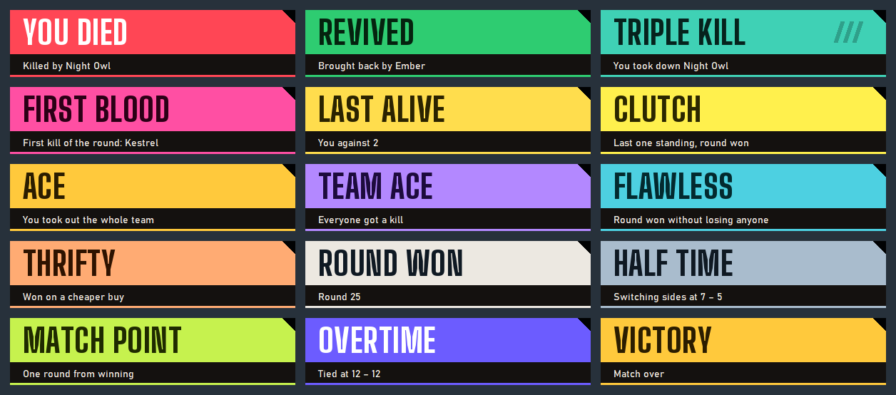

A banner slides in at the side of the screen for each event, in that event's colour.
They keep clear of the kill feed, score and the middle of the screen on their own.

To change them: **Settings → Pop-ups**: which side, how long they stay, and which kinds
of event get one. "Last alive" is off by default, because it would appear in the middle
of a clutch.

## 5. If something isn't picked up

The app reads three areas of the screen: the **kill feed** (top right), the **banner**
area (where ACE and CLUTCH appear) and the **score** (top centre). The defaults fit a
normal 16:9 screen. If kills or rounds are missed:

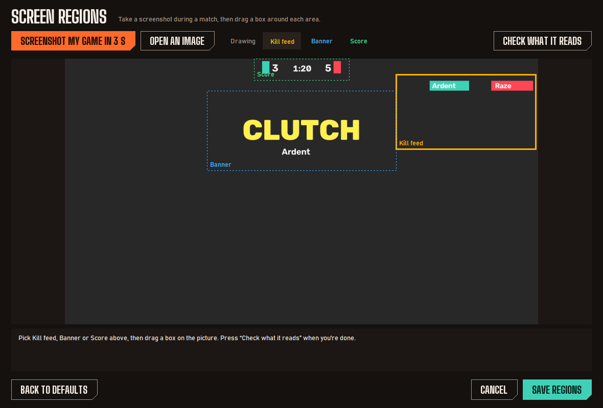

1. Click **Adjust screen regions**.
2. Press **Screenshot my game in 3 s** and switch to VALORANT during a match (a moment
   with a row or two in the kill feed is best).
3. Pick **Kill feed**, **Banner** or **Score**, and drag a box around it on the picture.
4. Press **Check what it reads**. You want ✓ lines like "you killed …" and "you 2 – 0 them".
5. **Save regions**.

If your kills still aren't counted, lower **Settings → Detection → Name match** to 0.7.
It means your name is being read slightly wrong.

## 6. Stream overlays in OBS

Five overlays for your stream, added to OBS as Browser sources. No plugin.

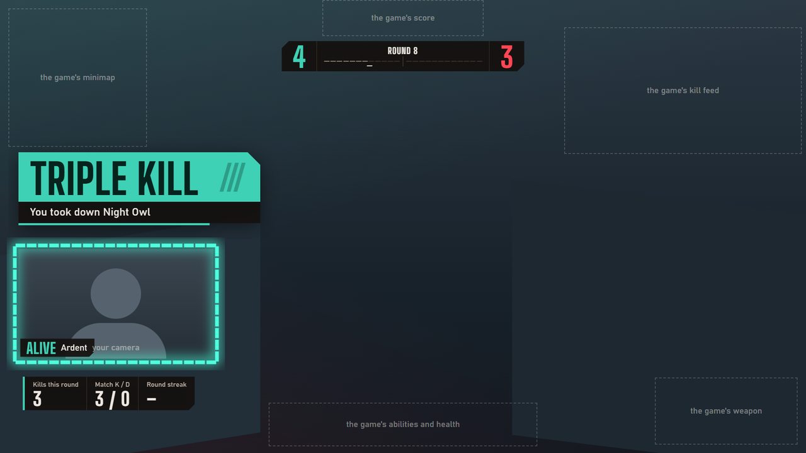

| overlay | what it shows |
|---|---|
| **Alerts** | a banner for the big moments: multi-kills, first blood, clutch, ace, the result |
| **Light frame** | a ring of lights around your webcam, in the event's colour |
| **Round tracker** | the score and one mark per round |
| **Numbers** | kills this round, K/D, streak |
| **Match card** | your match in numbers when it ends |

**Set up:**

1. **Settings → Stream**: tick **Serve overlays for OBS and drive LED strips**, and save.

   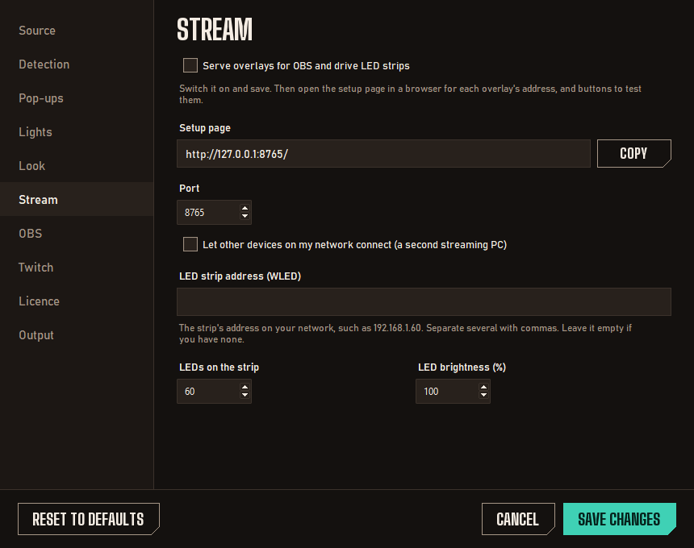

2. The main window now shows an address under **Stream overlays and lights**, normally
   `http://127.0.0.1:8765/`. Open it in your browser. It lists every overlay with its
   address and size, and has buttons to test them.

   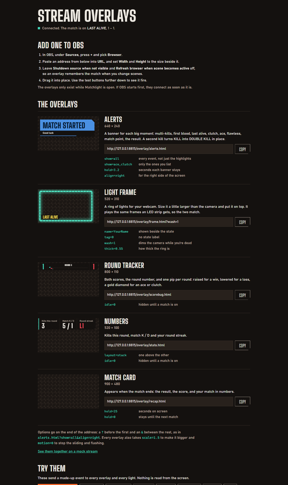

3. In OBS: **Sources → + → Browser**. Paste an overlay's address into **URL**, set the
   **Width** and **Height** listed for it, and press OK.
4. Drag it into place. Press a test button on the setup page to see it fire.

Keep the overlays away from the game's own minimap, score, kill feed and health bar. The
left side under the minimap is usually free. Matchlight has to be open for the overlays
to show anything; OBS reconnects to it by itself.

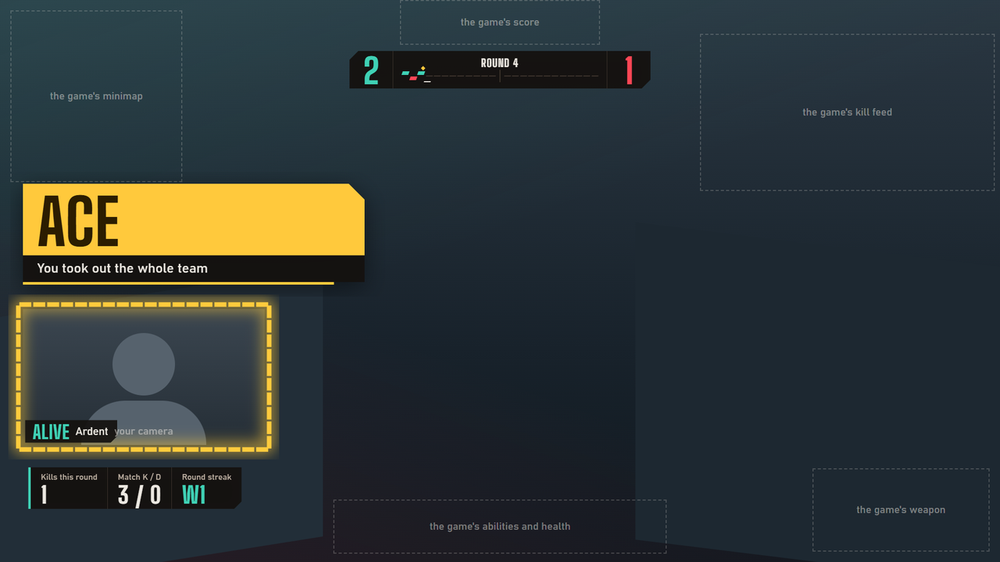

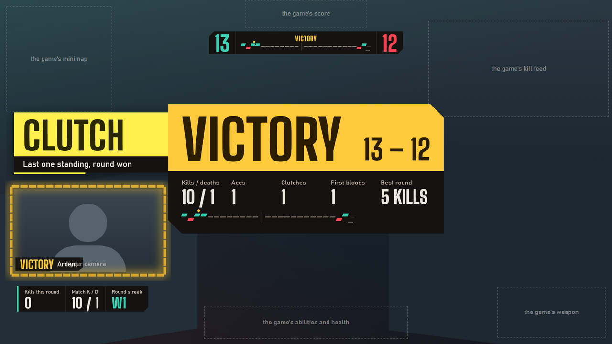

## 7. OBS camera and scenes

Matchlight can also control OBS directly:

- your **camera turns grey** while you're dead, and **flashes** in the event's colour on
  highlights;
- OBS **switches scenes**: a "dead" scene, back to your game scene, a highlight scene
  for a few seconds after an ace or clutch, and a victory or defeat scene.

**Set up:**

1. In OBS: **Tools → WebSocket Server Settings**. Tick **Enable WebSocket server**, press
   **Show Connect Info**, and copy the **Server Password**.
2. In Matchlight: **Settings → OBS**. Tick **Control OBS**, paste the password, and save.
3. Open **Settings → OBS** again. The line under the tick box should say "Connected to
   OBS…". The boxes now list your OBS sources and scenes.

   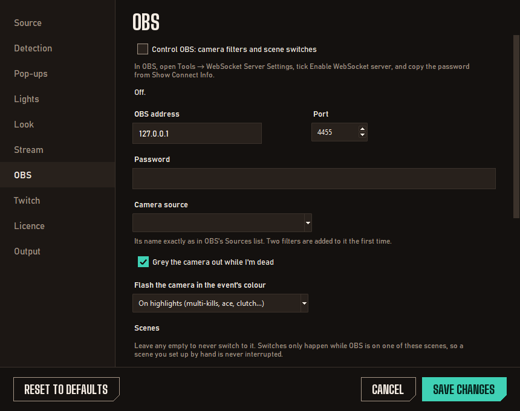

4. Pick your **camera source**, and the scenes you want (leave any empty to skip it).
   Save.
5. Click **Play a demo match** to watch it work.

It only switches away from the scenes you picked here. If you're on another scene, such
as "Just chatting", nothing moves.

## 8. Twitch markers and clips

While you're live, Matchlight can drop a **marker** on your stream at every highlight
(so you can find them all in the VOD later) and **clip** your aces and clutches.

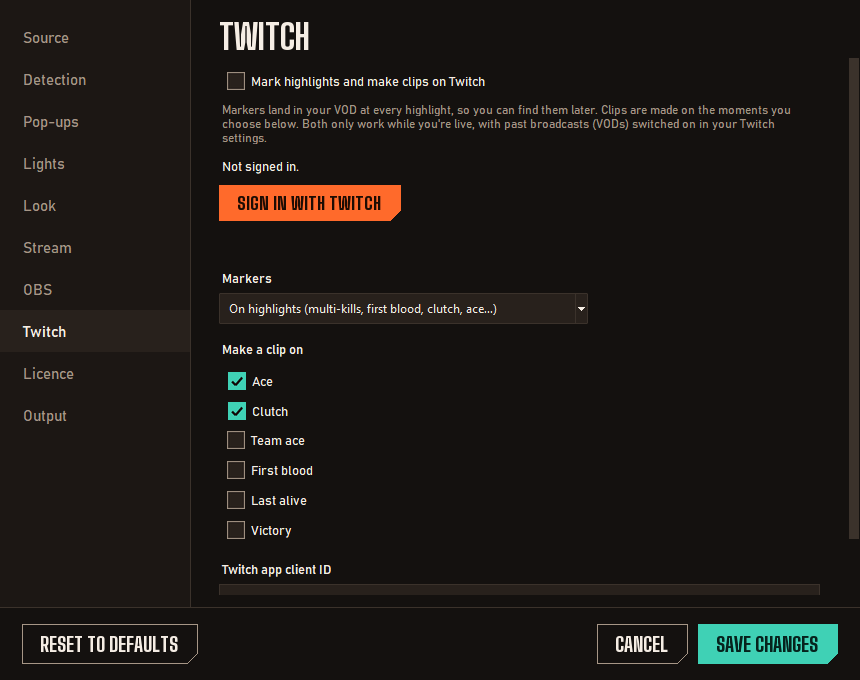

1. **Settings → Twitch → Sign in with Twitch.** A code appears. Open
   `twitch.tv/activate` in your browser, type the code, and approve.
2. Tick **Mark highlights and make clips on Twitch**, pick what gets clipped, and save.
3. In your Twitch settings, switch on **Store past broadcasts**. Twitch only allows
   markers when it's saving the stream.

Markers and clips only work while you're live. The **Log** window lists each new clip's
link, so you can trim and publish it.

## 9. LED strips

A strip of addressable LEDs on your desk or behind your monitor can play the same lights
as the strip at the top of the window. You need:

- an **ESP32** board, a **WS2812B 5 V** LED strip and a **5 V power supply** (about 900 EGP
  for one metre from Egyptian electronics shops);
- **WLED**, free software you put on the board from **install.wled.me**.

Once WLED is running and on your Wi-Fi, enter its address and LED count in
**Settings → Stream** and save. The strip lights up within a second; the setup page's test
buttons make it flash.

The full guide, with wiring and a shopping list, is
LED strips.

## 10. Problems

| what happens | try |
|---|---|
| Nothing is detected | Is your **name** right, without the #tag? Is the right **display** picked? Then check the [screen regions](#5-if-something-isnt-picked-up) |
| Kills are missed | Settings → Detection → **Name match** to 0.7 |
| Banners don't appear over the game | VALORANT must be in **Windowed Fullscreen** |
| The first seconds after Start are slow | normal: the text reader is loading |
| An overlay in OBS is empty | Matchlight must be open with **Stream** ticked. Open the setup page in a browser: if it doesn't load, that's why |
| "Can't reach OBS" | OBS must be open, with **Enable WebSocket server** ticked |
| "OBS refused the password" | copy it again from OBS's **Show Connect Info** |
| Twitch says "you're not live" | markers and clips only work during a stream, with **Store past broadcasts** on |
| The game feels slower | Settings → Detection → lower **Frames per second** to 5 |

## 11. Reporting a bug

[Open an issue](https://github.com/esistfarouk/matchlight-releases/issues) and include:

1. what you expected and what happened;
2. the text from the **Log** window (top right of the app);
3. if you can, turn on **Settings → Output → Save event frames to folder**, play a round,
   and attach a picture where it got something wrong.

---

Matchlight isn't endorsed by Riot Games and doesn't reflect the views or opinions of Riot
Games or anyone officially involved in producing or managing Riot Games properties. Riot
Games and VALORANT are trademarks or registered trademarks of Riot Games, Inc.
