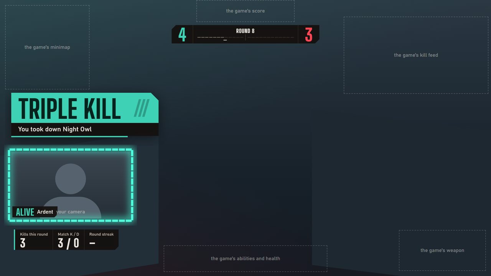

# Matchlight

Your VALORANT match, live: a banner for every kill, clutch and ace, overlays for your
stream, your OBS camera and scenes reacting to the round, and LED strips that light up
with it. It works by **looking at the screen**, like OBS does. It never reads the game's
memory and never touches your keyboard or mouse.

## Download

**[Latest release →](https://github.com/esistfarouk/matchlight-releases/releases/latest)**:
download `Matchlight.exe`, put it in a folder of its own, and double-click it. Windows 10
or 11.

Releases named **beta** are test builds. Every release lists what changed.

Windows may say it protected your PC: the exe isn't code-signed yet. Press **More info →
Run anyway**.

## How to use it

- **[Manual](MANUAL.md)**: first run, the banners, stream overlays, OBS camera and
  scenes, LED strips, and fixes for common problems.
- **[LED strips](LED-STRIPS.md)**: what to buy, wiring and set-up.

## Found a problem?

[Open an issue](https://github.com/esistfarouk/matchlight-releases/issues) with what you
expected, what happened, and the text from the app's **Log** window.

---

Matchlight isn't endorsed by Riot Games and doesn't reflect the views or opinions of Riot
Games or anyone officially involved in producing or managing Riot Games properties. Riot
Games and VALORANT are trademarks or registered trademarks of Riot Games, Inc.
